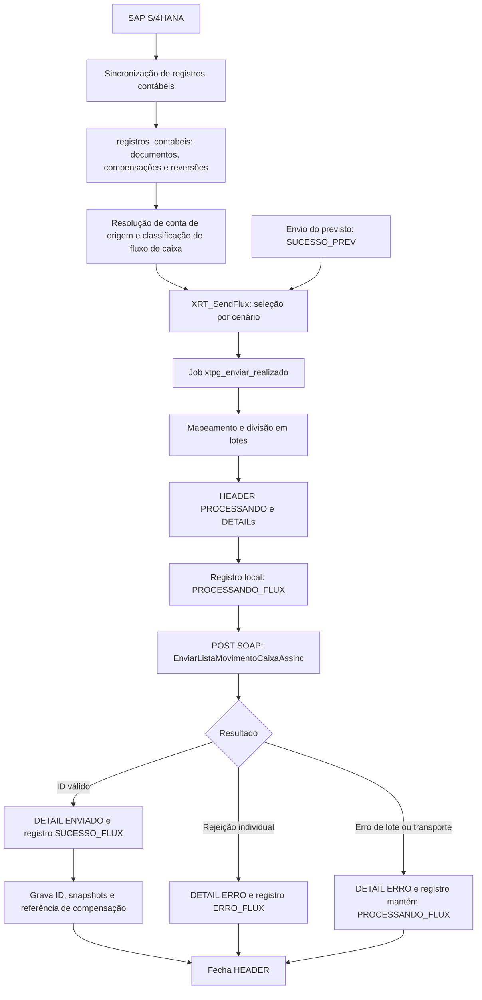

# Fluxo completo do envio de realizado ao XTPG

Documento baseado no código do repositório, revisado em 02/10/2026. Descreve a integração de **entrada no XTPG**, fluxo `REALIZADO` / `SendFlux`, desde os registros contábeis sincronizados até o retorno SOAP e a atualização local.

As regras SQL abaixo usam como referência a definição consolidada em [alter_XRT_SendFlux__DTZ-284_lcm_conta_banco.sql](prisma/s4_extensao_dotz/manual_sql/alter_XRT_SendFlux__DTZ-284_lcm_conta_banco.sql). Existem outras versões e backups no repositório. A definição aplicada em cada banco deve ser conferida: este documento não comprova implantação em homologação ou produção.

## 1. Visão geral



O previsto e o realizado têm jobs, views e logs separados. Nos ramos de pagamento, `SUCESSO_PREV` é uma condição para selecionar o documento original. O ramo de lançamento contábil direto e o ramo de estorno de CP têm condições próprias, sem essa exigência.

## 2. Preparação dos dados

A sincronização com SAP alimenta `s4_extensao_dotz.dbo.registros_contabeis`, incluindo documentos originais, pagamentos, itens, valores, datas, conta contábil, parceiro, compensação e reversão.

Referências:

- [SyncRegistrosContabeisService.ts](src/cron/modules/registros-contabeis/services/SyncRegistrosContabeisService.ts).
- [resolveContaOrigemXtpg.ts](src/cron/modules/registros-contabeis/sql/resolveContaOrigemXtpg.ts): resolução de `xtpg_conta_origem`.
- [DeduzirItemFluxoCaixaXtpgService.ts](src/cron/modules/fluxo-caixa-xtpg/services/DeduzirItemFluxoCaixaXtpgService.ts): classificação do item de fluxo de caixa.

Ter a fatura no banco não garante que o pagamento e seus vínculos de compensação já estejam disponíveis. O envio recebe apenas o que a view retorna; o serviço TypeScript não busca documentos faltantes no SAP durante o envio.

## 3. Seleção na XRT_SendFlux

### 3.1. CTEs de pagamentos manuais

A definição de referência prepara três conjuntos:

1. `pgtos`: identifica documentos de compensação de fornecedores/clientes (`financial_account_type` em `K`, `D`), exclui usuário `BANKPLUS` e exige `status_para_envio IS NULL` no documento de pagamento. Separa pagamentos não revertidos e revertidos.
2. `lista`: agrega os itens do pagamento/reversão, calculando residual, retenção, descontos, valor liquidado e líquido.
3. `Lst_xtpg`: vincula os pagamentos às faturas compensadas e calcula o valor realizado por item. No caminho normal usa empresa, exercício de compensação, documento de compensação e `clearing_item`; nas reversões utiliza também os campos preservados `sav_*`.

Esses vínculos dependem dos registros de ambos os lados da compensação. Documento ausente, exercício divergente ou item de compensação incompatível pode impedir a seleção.

### 3.2. Cinco ramos de saída

| Ordem / BlocoSAP | Cenário | Condições principais |
| --- | --- | --- |
| 1 / `Pagto Prev Rever` | Reversão de pagamento manual pela fatura original | Item `K`/`D`, origem `Reversao` em `Lst_xtpg`, original com `SUCESSO_PREV`, dados preservados de compensação. Um `NOT EXISTS` exclui reversões já cobertas pelo ramo de estorno de CP. |
| 10 / `Pagto Previsto` | Realizado de pagamento manual | Item `K`/`D`, origem `Manual` em `Lst_xtpg`, compensação preenchida e original com `SUCESSO_PREV`. Apesar do nome do bloco, esta linha pertence ao realizado. |
| 20 / `Pagto Prev Bank Plus` | Pagamento BankPlus | Linha `R21` com tipo `K`/`D`, `posting_key = '21'`, compensação preenchida, usuário `BANKPLUS`; original `RC` com `SUCESSO_PREV`. |
| 30 / `LCM` | Lançamento contábil direto na conta bancária | Documento `SA`/`AB`, conta cadastrada em `contas_bancarias` para a empresa, status nulo, item de fluxo preenchido e diferente de `''`, `'0'`, `'999'`, usuário diferente de `BANKPLUS`. |
| 40 / `Pagto Estorno CP` | Estorno do documento de compensação | Linha de reversão `K`/`D`, `is_reversal = 'X'`, compensação igual ao próprio documento, documento revertido diferente da compensação, status nulo e vínculo com o documento original conforme os predicados do ramo. |

No BankPlus, o vínculo entre `R21` e `RC` usa `assignment_reference`: quatro caracteres de exercício, dez de documento e três de item, além da empresa. Conteúdo incompatível pode impedir o vínculo; conversão inválida do item também pode provocar erro SQL.

No estorno de CP, se houver alguma linha `K`/`D` marcada com `clearing_is_reversed = 'X'` no documento, somente as linhas marcadas são selecionadas. Quando nenhuma está marcada, o ramo preserva a seleção das demais linhas elegíveis.

**Não existe uma regra universal de status nulo para toda a view.** Nos pagamentos manuais, o compensador deve ter status nulo e a fatura deve ter `SUCESSO_PREV`. BankPlus, LCM e estornos usam os predicados específicos acima.

### 3.3. Contas e cadastros que podem excluir linhas

Os ramos usam `INNER JOIN` com `cia` e funções por `CROSS APPLY`:

- `fn_RetornaContaPagamento`: conta do pagamento, nos ramos de pagamento/reversão.
- `fn_RetornaContaBancaria`: banco, agência e conta no cadastro de integração.
- `fn_RetornaContraPartida`: contrapartida contábil.

Um `CROSS APPLY` sem resultado elimina a linha. Mesmo quando `xtpg_conta_origem` está preenchida, a presença do `CROSS APPLY` continua exigindo resultado da função usada naquele ramo. O cadastro de empresa também precisa corresponder.

O parceiro em `Dotz_Stage_Trocas.dbo.OCRD` é obtido por `LEFT OUTER JOIN`; sua ausência, por si só, não elimina a linha nessa junção, mas pode resultar em campos vazios no payload.

### 3.4. Valores, contas e datas

O TypeScript envia o `Liq` calculado pela view; não recalcula o pagamento.

- Manual: o SQL agrega líquido, retenções e descontos e faz rateio por item. Com `ValorLiq_bruto <> 0`, a expressão de `Valor_realizado_com_desconto` é `ROUND((valor_da_fatura / ValorLiq_bruto) * (ValorLiquido + Valor_descontos), 2)`; caso contrário usa `ValorLiquido - Withholding_tax_amount - cash_discount_amount_in_company_code_currency`. O ramo aplica seu sinal final por tipo de parceiro.
- BankPlus: usa o valor de `R21`, com sinal definido pelo tipo do parceiro original.
- LCM: usa `amount_in_company_code_currency` da linha bancária.
- Reversão pela fatura: utiliza os cálculos próprios da CTE de reversão e o sinal do ramo.
- Estorno de CP: tenta localizar o realizado enviado no log e usa `-valor_enviado`; na ausência, usa `-ABS(valor_da_linha_de_estorno)`. O pareamento usa empresa, compensação e valor absoluto da fatura, com o log mais recente. Valores iguais entre faturas podem tornar a rastreabilidade ambígua.

`Conta_contabil` privilegia `xtpg_conta_origem`. Nos ramos de pagamento, o fallback é a conta retornada pela função de contrapartida; no LCM é `rc.gl_account`, a conta bancária da linha. `Conta_contrapartida` vem de `fncCtra.gl_account` e alimenta uma tag distinta.

`Data_de_lancamento` usa a data de compensação nos pagamentos e a data de lançamento nos ramos LCM/estorno de CP. Na definição de referência, `temperatura` é `-1` nos cinco ramos.

Para linhas G/L do LCM, o SQL transforma crédito (`debit_credit_code = 'H'`) em `AP` / forma `T`; os demais casos do fallback usam `AR` / forma `K`. A classificação do payload usa `Diario_original2`, não o campo informativo `OBJ`.

## 4. Acionamento e configuração

O job [xtpgEnviarRealizadoJob.ts](src/cron/jobs/xtpgEnviarRealizadoJob.ts), chave `xtpg_enviar_realizado`, chama `EnviarRealizadoXtpgService.execute()`, que cria o serviço compartilhado com configuração `REALIZADO`. O job declara `manualTrigger: true`.

| Variável | Padrão no código | Uso |
| --- | --- | --- |
| `CRON_XTPG_SEND_FLUX_ENABLED` | Habilitado somente se igual a `'true'` | Execução agendada |
| `CRON_XTPG_SEND_FLUX` | `0 */4 * * *` | Agendamento a cada quatro horas |
| `XTPG_SEND_FLUX_BATCH_SIZE` | `50` | Movimentos por requisição |
| `XTPG_SEND_FLUX_MAX_PER_RUN` | `0` | Limite por execução; zero significa sem limite |
| `XTPG_VIEW_DATASOURCE` | `s4` | `s4` usa client S4; outros valores caem no client Stage |
| `XTPG_VIEW_REALIZADO` | `XRT_SendFlux` | View consultada |
| `XTPG_API_BASE_URL` | `https://apih.deepxrtbr.com.br` | Base do endpoint |
| `XTPG_API_ENDPOINT` | `/dotz/SOAP_API/ITF/Entrada.asmx` | Endpoint SOAP |
| `XTPG_API_TIMEOUT_MS` | `120000` | Timeout de requisição |
| `XTPG_API_USUARIO`, `XTPG_API_SENHA` | Strings vazias | Autenticação no cabeçalho SOAP |

Esses valores são padrões de [config.ts](src/config/config.ts), não os valores efetivos do ambiente.

## 5. Leitura e montagem dos movimentos

[XtpgViewRepository.ts](src/cron/modules/xtpg-envio/repositories/XtpgViewRepository.ts) executa `SELECT * FROM <view>`, ou `SELECT TOP (limite) * FROM <view>` quando o limite é positivo. Valida o identificador da view. Não acrescenta filtros de negócio nem `ORDER BY`: a coluna `ordem` não garante a ordem de processamento.

[EnviarXtpgBaseService.ts](src/cron/modules/xtpg-envio/services/EnviarXtpgBaseService.ts) impede sobreposição de `execute()` para o mesmo fluxo por um `Set` em memória. Essa proteção é local ao processo e independente por fluxo; não serializa previsto com realizado nem coordena várias instâncias.

Sem linhas, retorna todas as métricas zeradas. Com linhas, o mapper cria tags ordenadas, mapa de valores, chave local e snapshots; depois o serviço divide os movimentos em lotes processados sequencialmente.

### 5.1. Mapeamento SOAP do realizado

Ordem definida em [xtpgFieldMap.ts](src/cron/modules/xtpg-envio/config/xtpgFieldMap.ts):

| Tag | Origem |
| --- | --- |
| `PfjNome` | `Nome_do_cliente_fornecedor` |
| `PfjCpf` | `CNPJ_Fornecedor` |
| `BanCodigo` | `Banco` |
| `AgeCodigo` | `Agencia` |
| `CntCodigo` | `Conta` |
| `TdpCodigo` | `Forma_de_Pagamento` |
| `DocPagador` | Data atual do processo em `yyyyMMdd` |
| `PfjCodigo` | `Empresa` |
| `ValorOriginal` | `Liq` |
| `Valor` | `Liq` |
| `ContaContabil` | `Conta_contabil` (código da conta) |
| `OrigemSistema` | `Diario_original2` |
| `OrigemPk` | `Chave_da_transacao` |
| `MmiCodigo` | `CFWId` |
| `Temperatura` | `temperatura` |
| `DocOrigem` | `Nr_Nota`, truncado em 15 caracteres |
| `InformacoesContabeis` | `Conta_contrapartida` |
| `DataCaixa` | `Data_de_lancamento` |
| `DataCompetencia` | `Data_de_lancamento` |
| `DataPagamento` | `Data_de_lancamento` |
| `Dff01` | `Cod_Fornecedor` |
| `Dff02` | `Nr_Nota`, sem o truncamento de `DocOrigem` |
| `MoedaCodigo` | Constante `BRL` |

O realizado não envia a tag `Historico`. Nulos viram strings vazias; strings recebem `trim`; valores substituem vírgula por ponto. Datas são convertidas para `yyyy-MM-ddT00:00:00.000`; datas não interpretáveis viram string vazia. O mapper atual usa suas próprias rotinas de data, com componentes locais do processo.

### 5.2. Chave local versus chave enviada

A chave usada para atualizar `registros_contabeis` e armazenada em `origem_doc_entry` é montada por:

```text
Company_code-fiscal_year-accounting_document-Accounting_document_item
```

Ela tem quatro partes. O parser rejeita chave incompleta ou com quantidade diferente de partes.

Já `OrigemPk`, enviada ao XTPG, vem de `Chave_da_transacao`. Nos pagamentos pode incluir também o documento de compensação/reversão; no LCM é a chave da linha. A coluna SQL `CHAVE` não é a chave local efetivamente usada quando o spec define as quatro colunas de origem.

### 5.3. Snapshot de compensação/reversão

O mapper resolve:

| Snapshot | Coluna principal | Fallback quando vazia |
| --- | --- | --- |
| `savClearAccDoc` | `clearing_accounting_document` | `p_accounting_document` |
| `savClearDocFiscalYear` | `clearing_doc_fiscal_year` | `p_fiscal_year` |
| `savClearItem` | `clearing_item` | `P_clearing_item` |
| `savRevDoc` | `reverse_document` | Sem fallback |
| `savRevDocFiscalYear` | `reverse_document_fiscal_year` | Sem fallback |

Os snapshots são preservados no registro original somente após sucesso, para apoiar cenários posteriores de reversão em que o SAP limpa campos de compensação.

## 6. Processamento de cada lote

1. Monta o XML inicial do lote.
2. Cria `xtpg_envio_realizado_header` com `PROCESSANDO`, quantidade e request.
3. Cria um `xtpg_envio_realizado_detail` por movimento, contendo origem e espelho das tags. O status inicial do detalhe é `ENVIADO`, antes da resposta.
4. Tenta marcar cada registro original como `PROCESSANDO_FLUX` antes do POST.
5. Envia o lote por SOAP.
6. Atualiza cada detalhe com `ENVIADO` ou `ERRO`, `id_xrt` e `mensagem_erro`.
7. Se não houve erro de lote, tenta finalizar cada registro com `SUCESSO_FLUX` ou `ERRO_FLUX`.
8. Se houve erro de lote, mantém os registros pré-marcados em `PROCESSANDO_FLUX`.
9. Fecha o header com status final, request retornado pelo cliente, response e erro de lote.

As operações não estão agrupadas em uma transação envolvendo logs, marcações e envio externo. Erros de persistência de header/detail podem interromper a execução. Erros ao marcar registros são capturados e registrados em log; o serviço continua, inclusive se a pré-marcação falhar.

## 7. SOAP e interpretação da resposta

[buildSoapEnvelope.ts](src/cron/modules/xtpg-envio/soap/buildSoapEnvelope.ts) monta um envelope SOAP com namespace `http://deepxrtbrasil.com.br/`, cabeçalho `ValidationSoapHeader` e operação `EnviarListaMovimentoCaixaAssinc`. Cada movimento fica em `listaMovimentos`, com caracteres reservados escapados.

[XtpgSoapClient.ts](src/cron/modules/xtpg-envio/soap/XtpgSoapClient.ts) usa POST, `Content-Type: text/xml; charset=utf-8` e timeout configurado. Não há consulta posterior de status nessa rotina; o sucesso local usa o retorno imediato da operação.

### 7.1. Pareamento dos retornos

- Extrai blocos `MovimentoRecebido` e lê `ID`, `MensagemErro` e `OrigemPk`.
- Quando a quantidade de blocos é igual à quantidade enviada, casa **por posição**. Se as chaves divergem, emite aviso, mas mantém o resultado posicional.
- Quando as quantidades divergem, tenta casar por `OrigemPk`. Sem correspondência, retorna erro individual. O mapa por chave mantém apenas um retorno por chave repetida.
- Sem nenhum bloco, usa `MensagemErro`, `faultstring` ou `Resposta XTPG sem MovimentoRecebido` como erro de lote.

O comportamento acima é o da implementação, mesmo que comentários antigos do cliente descrevam outra prioridade de pareamento.

### 7.2. Critério de sucesso

O movimento é considerado aceito quando o `ID` não é vazio e não é `00000000-0000-0000-0000-000000000000`. O código não valida o formato completo de UUID. Com ID aceito, define sucesso e limpa `mensagemErro`; sem ID aceito, usa a mensagem recebida ou `Movimento rejeitado pela XTPG`.

HTTP 4xx produz erro de lote explícito; HTTP 5xx, timeout e falhas de rede passam pelo tratamento de exceção. Todos resultam em erro de lote, sem finalização do status local. Uma resposta HTTP 200 pode conter rejeições de negócio.

## 8. Atualização local e estados

| Resultado | DETAIL | Registro original | HEADER |
| --- | --- | --- | --- |
| Todos aceitos | `ENVIADO` | `SUCESSO_FLUX` | `ENVIADO` |
| Aceitação parcial | `ENVIADO` ou `ERRO` por movimento | `SUCESSO_FLUX` ou `ERRO_FLUX` | `PARCIAL` |
| Todos rejeitados individualmente | `ERRO` | `ERRO_FLUX` | `ERRO` |
| Erro de lote/transporte | `ERRO` | Mantém `PROCESSANDO_FLUX`, se pré-marcação funcionou | `ERRO` |

No sucesso do envio normal, o serviço tenta:

1. Atualizar o original pela PK composta com `SUCESSO_FLUX` e `IdXRT`.
2. Gravar os cinco snapshots `Sav*` e `EnvioID`, o ID do detalhe.
3. Copiar o valor atual de `clearing_accounting_document` para `Ult_Doc_Pgto` no original.
4. Marcar a referência de compensação com `SUCESSO_FLUX`, quando os três campos de compensação do snapshot estão preenchidos.

O quarto passo usa exatamente estes filtros:

```text
company_code = empresa do original
fiscal_year = savClearDocFiscalYear
clearing_accounting_document = savClearAccDoc
clearing_item = savClearItem
```

Não procura a referência por `accounting_document`/`accounting_document_item` e pode afetar mais de uma linha correspondente. Essa atualização escreve apenas o status.

No erro individual, escreve apenas `ERRO_FLUX`; não limpa automaticamente IDs/snapshots anteriores. A coluna SQL `proximo_status` não controla a finalização: o TypeScript calcula o status pelo fluxo e pelo resultado SOAP.

As métricas `totalEnviados`/`totalErros` contam resultados SOAP. Como falhas de atualização local são capturadas, sucesso no SOAP não comprova que todas as marcações locais foram concluídas. O job expõe `totalReceived = totalLidos` e `totalUpdated = totalEnviados`.

## 9. Por que só o previsto pode mudar no primeiro envio

| Situação | Efeito no realizado | Onde conferir |
| --- | --- | --- |
| Pagamento ainda não sincronizado | As CTEs não localizam a compensação | Original e documento de pagamento em `registros_contabeis` |
| Vínculo de compensação divergente | A fatura não entra no conjunto de realizado | Empresa, exercícios, documento e item de compensação |
| Original ainda sem `SUCESSO_PREV` na leitura | Ramos de pagamento não selecionam a linha | Status e horários das execuções de previsto/realizado |
| Cadastro bancário, empresa ou contrapartida sem resultado | `INNER JOIN`/`CROSS APPLY` exclui a linha | Cadastro e funções SQL do ramo |
| Referência BankPlus incompatível | Não encontra original ou ocorre erro SQL | `assignment_reference` e campos de `R21` |
| LCM sem classificação válida | Gate exclui a linha | Item de fluxo e classificação |
| Job realizado desativado ou ainda não executado | Nenhuma tentativa de envio | Configuração efetiva e execução do job |
| Rejeição do XTPG | Tentativa registrada com erro individual | DETAIL e resposta SOAP |
| Falha de lote/transporte | Registro pode ficar em `PROCESSANDO_FLUX` | HEADER, DETAIL e logs da execução |

O previsto e o realizado podem ter o mesmo agendamento padrão, mas não há encadeamento entre os serviços que garanta a execução do realizado depois do sucesso do previsto. Um cenário pode ficar elegível somente após a leitura feita pelo job naquele ciclo.

## 10. Consultas de diagnóstico somente leitura

Execute no banco/fonte efetivamente configurado. Substitua os valores de exemplo; mantenha documentos, itens e exercícios como strings para preservar zeros à esquerda.

### 10.1. Conferir a definição aplicada

```sql
SELECT OBJECT_DEFINITION(OBJECT_ID(N'dbo.XRT_SendFlux')) AS definicao;
```

Se a configuração usa outro nome/schema, ajuste a consulta. Compare os ramos, filtros e colunas com o script de referência; aplicar um script antigo pode substituir correções posteriores.

### 10.2. Consultar o original e seus vínculos

```sql
DECLARE @empresa nvarchar(10) = N'EMPRESA';
DECLARE @exercicio nvarchar(4) = N'2026';
DECLARE @documento nvarchar(20) = N'DOCUMENTO';

SELECT company_code, fiscal_year, accounting_document, accounting_document_item,
       financial_account_type, accounting_document_type, posting_key,
       accounting_doc_created_by_user, status_para_envio, id_xrt,
       item_fluxo_de_caixa, gl_account, house_bank, house_bank_account,
       clearing_accounting_document, clearing_doc_fiscal_year, clearing_item,
       reverse_document, reverse_document_fiscal_year,
       sav_clear_acc_doc, sav_clear_doc_fiscal_year, sav_clear_item
FROM dbo.registros_contabeis
WHERE company_code = @empresa
  AND fiscal_year = @exercicio
  AND accounting_document = @documento;
```

Consulte também o documento de compensação com o exercício indicado em `clearing_doc_fiscal_year` e, quando aplicável, o documento de reversão. Nos pagamentos manuais, confira separadamente status do original e status do compensador.

### 10.3. Verificar se está elegível agora

```sql
SELECT *
FROM dbo.XRT_SendFlux
WHERE Company_code = N'EMPRESA'
  AND fiscal_year = N'2026'
  AND accounting_document = N'DOCUMENTO';
```

Ausência na view depois de um envio aceito pode ser esperada: a atualização de status muda sua elegibilidade. A consulta retrata o estado atual, não a seleção histórica. Em estornos, consulte também o documento de reversão.

### 10.4. Consultar tentativas históricas

```sql
SELECT d.*, h.status AS status_lote,
       h.mensagem_erro AS erro_lote, h.response AS resposta_lote
FROM dbo.xtpg_envio_realizado_detail d
INNER JOIN dbo.xtpg_envio_realizado_header h
        ON h.id = d.xtpg_envio_realizado_header_id
WHERE d.origem_doc_entry = N'EMPRESA-2026-DOCUMENTO-ITEM'
ORDER BY d.id DESC;
```

Cruze `origem_doc_entry` (chave local), `origem_pk` (chave enviada), `status`, `id_xrt`, `mensagem_erro`, payload espelhado e resposta do lote. `DETAIL ENVIADO` isolado não comprova aceitação: esse é também o status inicial antes da resposta. Verifique o ID e o estado do header.

## 11. Consulta de logs e reprocessamento

Rotas administrativas autenticadas, montadas em `/xtpg-envios`:

- `GET /xtpg-envios/realizado/headers`: lista lotes.
- `GET /xtpg-envios/realizado/headers/:id`: consulta lote e detalhes.
- `POST /xtpg-envios/realizado/reprocessar`: recebe `detailIds` e `modo` (`resetar` ou `reenviar`).

O serviço considera elegíveis detalhes com `ERRO` ou cujo registro original está em `PROCESSANDO_FLUX`.

| Modo | Comportamento | Limitação |
| --- | --- | --- |
| `resetar` | Limpa `StatusParaEnvio` e `IdXRT` somente do original | Voltar a status nulo não garante reaparecimento na view: cada ramo mantém seus filtros e vínculos. |
| `reenviar` | Reconstrói tags do detalhe e envia imediatamente com novo lote/log | Reutiliza payload histórico; não lê novamente a view nem reconstrói snapshots `sav_*`. |

O reenvio chama `processar()` diretamente e não usa o guard de reentrância de `execute()`. Como `buildMovimentoFromDetail()` retorna `savFields: null`, esse caminho não grava novos snapshots nem faz a marcação de referência dependente deles. A cópia de `Ult_Doc_Pgto` ainda ocorre após sucesso.

Falhas de transporte deixam a aceitação externa incerta; o status `PROCESSANDO_FLUX` existe para permitir revisão antes de uma nova tentativa. Não há retry automático no cliente SOAP.

## 12. Arquivos principais

- [Job de realizado](src/cron/jobs/xtpgEnviarRealizadoJob.ts).
- [Service de realizado](src/cron/modules/xtpg-envio/services/EnviarRealizadoXtpgService.ts).
- [Factory e configuração por fluxo](src/cron/modules/xtpg-envio/services/xtpgEnvioFactory.ts).
- [Leitura da view](src/cron/modules/xtpg-envio/repositories/XtpgViewRepository.ts).
- [Spec de campos](src/cron/modules/xtpg-envio/config/xtpgFieldMap.ts).
- [Mapper e chaves](src/cron/modules/xtpg-envio/mappers/buildMovimentoXtpg.ts).
- [Orquestração, logs e atualização local](src/cron/modules/xtpg-envio/services/EnviarXtpgBaseService.ts).
- [Envelope SOAP](src/cron/modules/xtpg-envio/soap/buildSoapEnvelope.ts).
- [Cliente e interpretação da resposta](src/cron/modules/xtpg-envio/soap/XtpgSoapClient.ts).
- [Reprocessamento](src/modules/xtpg-envio/services/ReprocessarXtpgService.ts).
- [Models de logs Prisma](prisma/s4_extensao_dotz/schema.prisma).
- [Definição SQL de referência](prisma/s4_extensao_dotz/manual_sql/alter_XRT_SendFlux__DTZ-284_lcm_conta_banco.sql).
